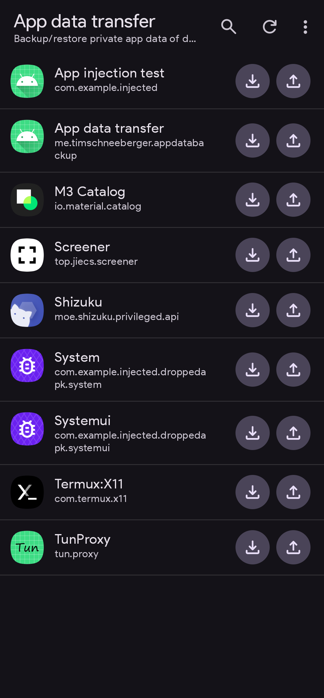

# debuggable-app-data-backup

This application can backup and restore private app data of **debuggable apps** using Shizuku without root. This includes credential-encrypted app data (`/data/data/{pkg}`) and device-encrypted app data (`/data/user_de/0/{pkg}`).
Exported data will be saved to `/sdcard/AppData`.

See [releases](https://github.com/timschneeb/debuggable-app-data-backup/releases) for downloads.

Again, this only applies to apps marked as debuggable. My personal use case for this was in combination with a system-level exploit that allowed me to execute arbitrary code as Android's `system_server`. Using its privileges, it was possible to rewrite Android's package manifest caches and trick the system into believing that any app was debuggable. As a consequence, it allowed any apps private data to be read and written using `run-as` or this tool.

